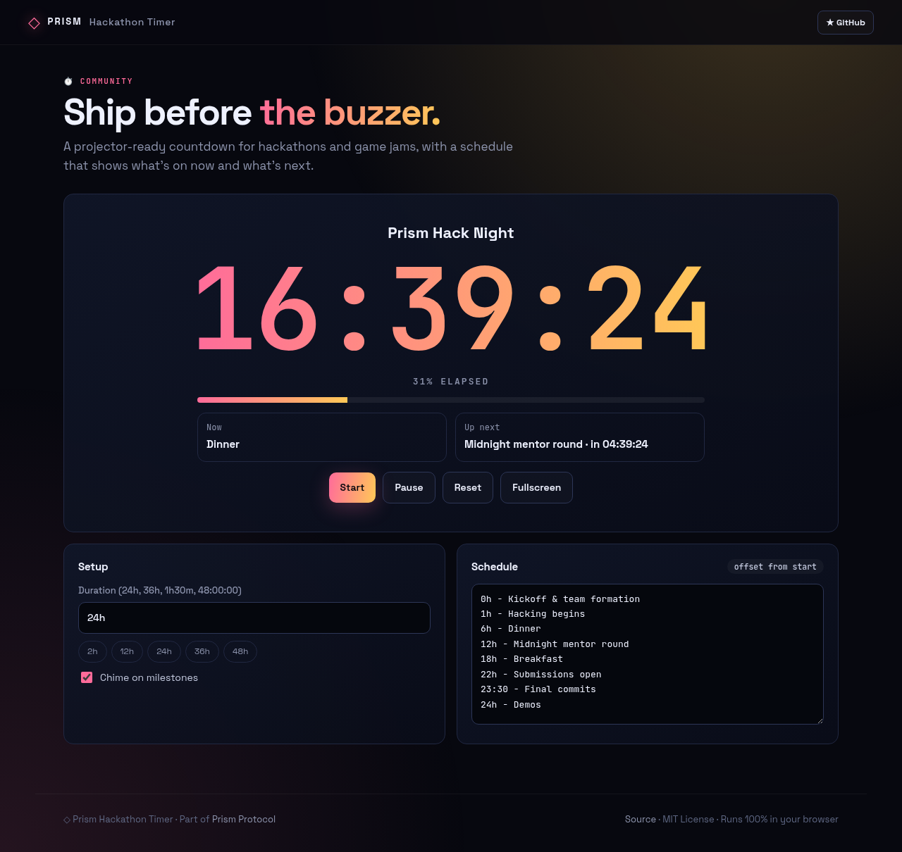
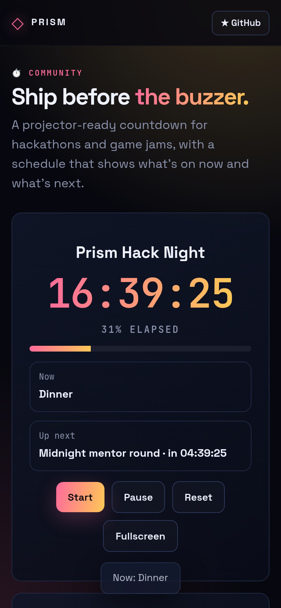

<!-- ═════════════ HEADER ═════════════ -->
<p align="center">
  
</p>

<p align="center">
  
</p>

<p align="center">
  <a href="https://github.com/krishyaa06/prism-hackathon-timer/actions/workflows/ci.yml"></a>
  <a href="https://krishyaa06.github.io/prism-hackathon-timer/"></a>
  
  
  <a href="LICENSE"></a>
</p>

<p align="center">
  
</p>


## ⚡ Overview

**Prism Hackathon Timer** is the countdown you put on the big screen at a hackathon, game jam or build sprint. Set a duration like `24h` or `1h30m`, paste a simple schedule (`6h - Dinner`), and the screen shows the giant timer, a progress bar, what's happening now and what's next. It warns in the final hour, pulses in the last five minutes, chimes on milestones and keeps its state across reloads.

## ✨ Features

- **Giant tabular countdown**, fullscreen mode for projectors
- **Schedule by offset** — `0h Kickoff`, `90m Talk`, `23:30 Final commits`
- **Now / Up next** cards with time until the next event
- **Phases**: running → final hour → final minutes → time's up, with chimes
- **Pause / resume / reset**, state saved locally (survives refresh)
- Shortcuts: `Space` start/pause, `F` fullscreen; editable event name

## 📸 Screenshots

<table>
  <tr>
    <td width="68%"></td>
    <td width="32%"></td>
  </tr>
</table>

## 🚀 Quick Start

**Use it online:** [https://krishyaa06.github.io/prism-hackathon-timer/](https://krishyaa06.github.io/prism-hackathon-timer/)

**Run locally:**

```bash
git clone https://github.com/krishyaa06/prism-hackathon-timer.git
cd prism-hackathon-timer
# open index.html in your browser, or serve it:
npx serve .
```

## 🛠️ Usage

1. Set the duration and edit the schedule (one `offset - title` per line).
2. Click the event name to rename it.
3. Press **Start** (or `Space`), then **Fullscreen** (or `F`) on the projector.

## 📁 Project Structure

```text
prism-hackathon-timer/
├── assets/
│   ├── logo.png
│   └── logo.svg
├── css/
│   ├── app.css
│   └── prism.css
├── js/
│   ├── app.js   # timer loop, chimes, fullscreen
│   ├── core.js   # duration/schedule parsing + status — tested in Node
│   └── prism.js
├── test/
│   └── core.test.js
├── .gitignore
├── LICENSE
├── README.md
├── index.html
└── package.json
```

## 🧪 Tests

```bash
npm test
```

Tests use the built-in `node:test` runner, so there is nothing to install. CI runs them on Node 20 and 22.

## 🤝 Contributing

1. Fork the repo and create a branch: `git checkout -b feature/my-idea`
2. Make your change and add a test in `test/`
3. Run `npm test` and open a Pull Request

## 🔷 Part of Prism Protocol

Prism Hackathon Timer is one of the open-source tools built by [Prism Protocol](https://dc.gg/prismprotocol), a tech community where young builders learn, ship and compete together.

## 👤 Author

<table>
  <tr>
    <td align="center">
      <a href="https://github.com/krishyaa06"><br><b>Soumya Bhandare</b></a><br>
      <sub>Founder @ Prism Protocol</sub>
    </td>
    <td>
      <a href="https://dc.gg/prismprotocol"></a><br>
      <a href="https://instagram.com/prism_protocol_"></a><br>
      <a href="https://x.com/krishyaa06"></a>
    </td>
  </tr>
</table>

## 📄 License

Released under the [MIT License](LICENSE).

<p align="center">
  <b>If you like this project, consider giving it a ⭐</b><br>
  <sub>"Build. Create. Compete." · Made with ⚡ by Prism Protocol</sub>
</p>


